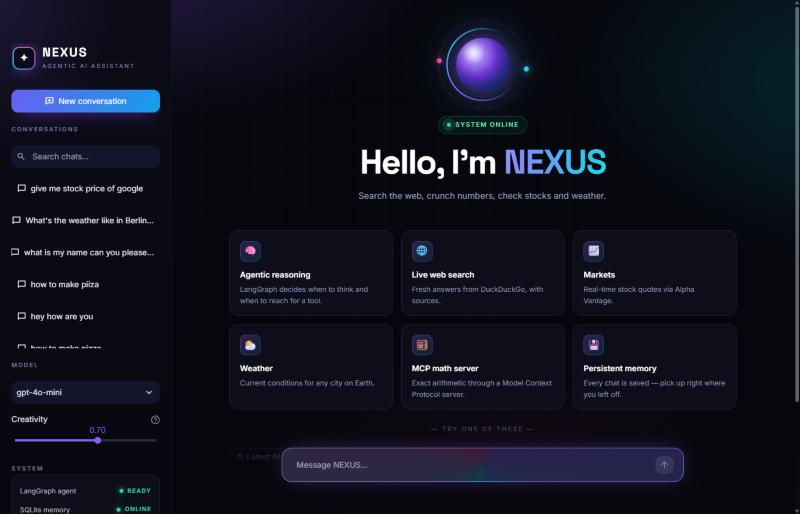
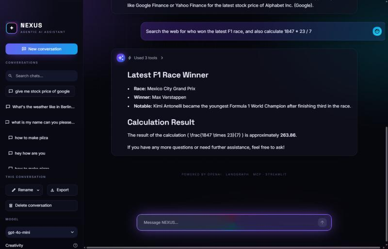

# ✦ NEXUS AI — Agentic chatbot (LangGraph + MCP + Streamlit)

An agentic AI assistant that decides **when to think and when to use a tool**.
Built with **LangGraph**, **OpenAI**, the **Model Context Protocol (MCP)** and a fully
animated **Streamlit** interface.




## Features

- **Agentic tool use** – LangGraph `StateGraph` with a tool-calling loop
  - 🌐 DuckDuckGo web search
  - 📈 Live stock quotes (Alpha Vantage)
  - ⛅ Live weather for any city (Open-Meteo, no key needed)
  - 🕒 Current date & time
  - 🧮 Math tools served from a local **MCP server** (stdio)
- **Real-time token streaming** with a live **tool-call timeline** (inputs + results)
- **Persistent memory** – every conversation is checkpointed in SQLite
- Conversation history sorted by recency, **search, rename, delete, export to Markdown**
- Model picker (GPT-4o-mini / 4.1-mini / 4o / 4.1) and creativity slider
- Animated UI: aurora background, glassmorphism, rotating gradient borders,
  orbiting hero orb, staggered card reveals, typing indicator

## Tech stack

Python · LangGraph · LangChain · OpenAI · MCP · Streamlit · SQLite

## Run locally

```bash
python -m venv .venv
.venv\Scripts\activate          # Windows  (source .venv/bin/activate on macOS/Linux)
pip install -r requirements.txt
copy .env.example .env          # then add your OPENAI_API_KEY
streamlit run streamlit_frontend.py
```

## Deploy

Works on Render / Streamlit Community Cloud. Set `OPENAI_API_KEY`
(and optionally `ALPHA_VANTAGE_API_KEY`) as environment variables or secrets.

Start command (Render):

```bash
streamlit run streamlit_frontend.py --server.port $PORT --server.address 0.0.0.0
```

## Project structure

```
langgraph_backend.py     # LangGraph agent, tools, MCP client, SQLite memory
streamlit_frontend.py    # Streamlit chat UI with streaming + tool timeline
assets/nexus.css         # animation & glass design layer
.streamlit/config.toml   # theme (colours, fonts)
mcp_servers/math_server.py  # FastMCP math server
```

Made by **Parth Vaghasiya**.
